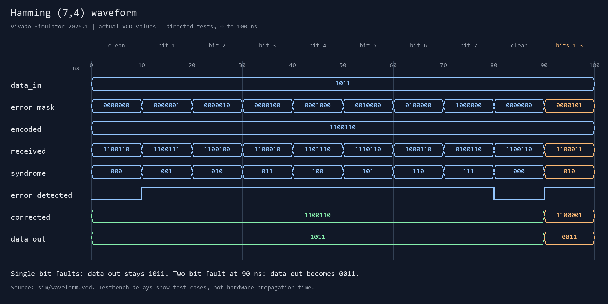
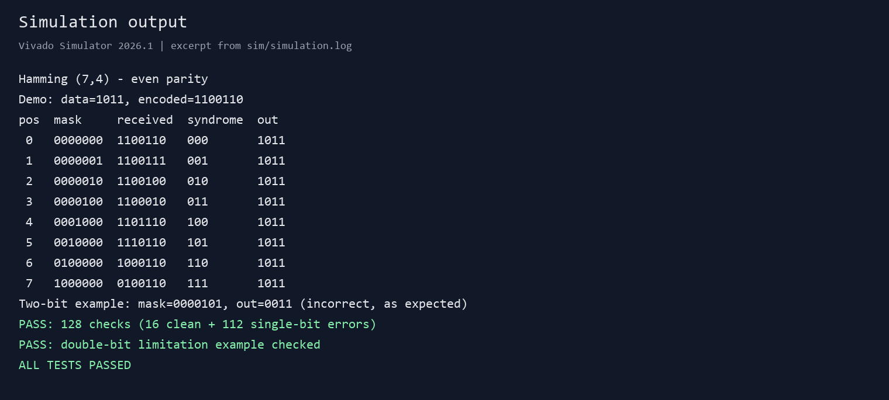

# Hamming (7,4) error check

A simple Verilog implementation of Hamming (7,4). It encodes 4 data bits into 7 bits and uses a syndrome to find and correct a single-bit error.

## How it works

Positions 1, 2 and 4 are parity bits. Positions 3, 5, 6 and 7 are data.

Parity is even. Each parity bit makes its group have an even number of 1s. P1 covers 1, 3, 5, 7. P2 covers 2, 3, 6, 7. P4 covers 4, 5, 6, 7.

`data_in[3]` goes to position 3, `data_in[2]` to 5, `data_in[1]` to 6 and `data_in[0]` to 7. Words are `[6:0]`, so position 7 prints first and 1 last. Data `1011` gives `1100110`.

The 3-bit syndrome is 0 with no error. For a single-bit error, values 1 to 7 give the flipped position, which is flipped back. Two flipped bits give a syndrome for the wrong bit, so the output stays wrong.

## Files

- [RTL](rtl/hamming74.v)
- [Testbench](tb/tb_hamming74.v)
- [Run script](scripts/run.ps1)
- [XSim script](scripts/simulate.tcl)
- [Waveform data](sim/waveform.vcd)
- [Simulation log](sim/simulation.log)

## Run it

Vivado 2026.1, in PowerShell:

```powershell
.\scripts\run.ps1
# Or specify your Vivado installation:
.\scripts\run.ps1 -VivadoBin "C:\Xilinx\Vivado\2026.1\bin"
```

Alternatively, with Icarus Verilog installed:

```powershell
New-Item -ItemType Directory -Force build, sim | Out-Null
iverilog -g2012 -s tb_hamming74 -o build/hamming74.vvp rtl/hamming74.v tb/tb_hamming74.v
vvp build/hamming74.vvp
```

Icarus writes `sim/waveform.vcd` via the `__ICARUS__` guard. XSim writes it via [simulate.tcl](scripts/simulate.tcl).

## Results

16 clean and 112 single-bit checks pass, 128 total, plus one two-bit check.



*Rendered from the XSim VCD. Clean 0-10 ns, positions 1-7 flipped 10-80 ns, clean 80-90 ns, mask `0000101` 90-100 ns gives `0011`.*



*Rendered from the XSim log. Single-bit cases recover `1011`. The two-bit case gives `0011`, wrong as expected.*

To regenerate the images, install Pillow and run `python scripts/render_images.py` after simulation.
