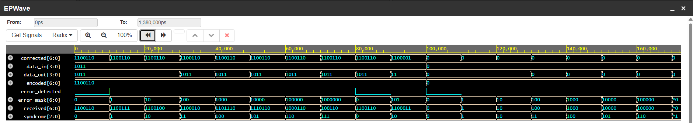
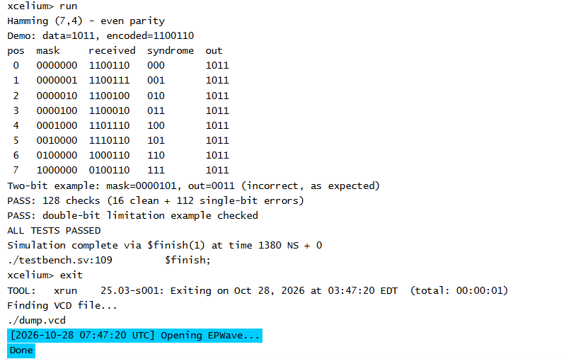

# Hamming (7,4) error check

Verilog that encodes 4 data bits into 7 bits and corrects one flipped bit, but not two.

## How it works

Positions 1/2/4 are parity bits and 3/5/6/7 are data. `data_in[3:0]` maps to positions 3/5/6/7 in order. Parity is even. P1 covers 1/3/5/7, P2 covers 2/3/6/7, and P4 covers 4/5/6/7. Position 7 is written first, so `1011` encodes to `1100110`.

With at most one flipped bit, syndrome 0 means no error. Values 1 to 7 name the flipped bit, and the decoder flips it back. With two flipped bits, the decoder flips the wrong bit and the data stays wrong.

## Run it on EDA Playground

Open the [saved playground](https://edaplayground.com/x/Dczm), titled "Hamming (7,4) error check", or copy in the [design](rtl/hamming74.v) and [testbench](tb/tb_hamming74.v), with `tb_hamming74` as top. In Tools & Simulators, pick Cadence Xcelium 25.03, using the SystemVerilog design/testbench editors. Set Compile Options to `-timescale 1ns/1ns -sysv` and Run Options to `-access +rw`. Tick Open EPWave after run, then click Run.

In EPWave, click Get Signals, open `tb_hamming74`, and pick signals. `$dumpfile("dump.vcd")` and `$dumpvars` are already set for Cadence.

## Results

I started with `1011`. It encodes to `1100110`. With no error the syndrome is `000` and `data_out` is `1011`. When I flip position 3 the received word becomes `1100010`. The syndrome is `011`, which points to position 3, so the decoder flips that bit back and `data_out` returns to `1011`.

*The EPWave timeline is in ps, so 20000 is 20 ns. It drops leading zeros, so `11` on `data_out` means `0011`.*

Flipping two bits is different. With mask `0000101`, positions 1 and 3, the received word is `1100011` and the syndrome is `010`. That makes the decoder flip position 2 instead, and `data_out` comes out as `0011` rather than `1011`. Hamming (7,4) only corrects a single bit, so it cannot recover the original from two flips. I also ran through all 16 inputs, flipping each bit one at a time.

